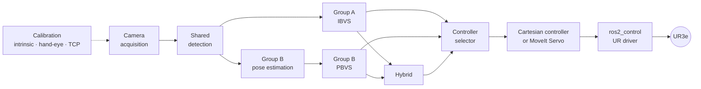

# UR3e Assistive Bottle Opening

**Vision-based robotic manipulation for one-handed users** — SIGMA Clermont, *Sensors and Robotic Applications* (Project-3A).

A person who can use only one hand holds a water bottle. A Universal Robots UR3e equipped with an RGB camera detects the bottle and its cap, approaches the cap while following the bottle's motion with visual servoing, grasps it, unscrews it, detects that it is free and lifts it about 3 cm.

> **Status (26/11/2026): planning baseline.** Architecture, conventions and roadmap are written; no robot functionality is implemented or validated yet. Live status: [`progress.yaml`](progress.yaml) and the project dashboard.

## Goals

| Graded step | Content |
| --- | --- |
| 1 — Acquisition and control | RGB acquisition, OpenCV and deep-learning image processing, intrinsic calibration compared with RealSense factory data, joint and Cartesian velocity control |
| 2 — Calibration | Hand-eye calibration, robot / camera / end-effector transforms, gripper TCP |
| 3 — Perception | ArUco detection and pose; detection: classical vs deep learning; 3D pose: classical vs deep learning vs structure from motion |
| 4 — Motion control | Open-loop MoveIt; IBVS, PBVS and hybrid visual servoing, compared experimentally |
| 5 — Application | Assistive bottle opening built on steps 1–4 |

Development starts with a bottle in a fixture. A person-held bottle is used only after validation, a risk assessment and approval from the professors.

## Architecture



Three blocks: **common upstream** (camera, calibration, detection), **two parallel visual servoing pipelines** (IBVS; pose estimation + PBVS), and **common downstream** (controller selection, Cartesian control, MoveIt, grasp and unscrew). Every controller publishes a `geometry_msgs/TwistStamped`, so classical and future learned controllers are interchangeable.

| Document | Content |
| --- | --- |
| [docs/architecture.md](docs/architecture.md) | Packages, interfaces, calibration and control flow, methodology |
| [docs/conventions.md](docs/conventions.md) | Frames, `T_A_B` notation, units, twists, robot model consistency |
| [docs/decisions.md](docs/decisions.md) | Architecture decisions D1–D14 |
| [docs/roadmap.md](docs/roadmap.md) | Phases, work packages, milestones, acceptance targets |
| [docs/workflow.md](docs/workflow.md) | Git workflow, code rules, experiments, progress tracking |
| [docs/SETUP.md](docs/SETUP.md) | Installation and build |
| [docs/PLAN.md](docs/PLAN.md) | The group's first plan (10/11/2026) |

## Repository layout

```text
ros2_ws/src/   ROS 2 packages, one folder per package (created as the work needs them)
experiments/   experiment configurations, metrics.json, plots (raw data stays outside Git)
media/         approved diagrams, figures and demo media
docs/          architecture, conventions, roadmap, workflow, setup
dl/            dataset scripts and training (no data, no weights)
reports/       one LaTeX report per graded step
data/          ignored by Git: datasets, bags, videos (shared Drive)
web/           project dashboard (React + TypeScript + Vite)
progress.yaml  single source of truth for project progress
```

Target ROS 2 packages: `ur3e_bringup`, `ur3e_description`, `ur3e_moveit_config`, `ur3e_camera`, `ur3e_calibration`, `ur3e_geometry`, `ur3e_perception`, `ur3e_pose_estimation`, `ur3e_ibvs`, `ur3e_pbvs`, `ur3e_hybrid`, `ur3e_control`, `ur3e_manipulation`, `ur3e_task_manager`, `ur3e_simulation` (deferred: `ur3e_learning`, `ur3e_interfaces`). See [docs/architecture.md](docs/architecture.md#3-packages).

## Platform

Ubuntu 22.04 · ROS 2 Humble · `ur_robot_driver` · ros2_control · MoveIt 2 / MoveIt Servo · OpenCV · PyTorch · NumPy / SciPy.
Hardware: UR3e, Intel RealSense (RGB only for perception; model to confirm), OnRobot gripper (model to confirm).

## Quick start

```bash
# ROS 2 workspace (packages are added progressively)
cd ros2_ws
rosdep install --from-paths src --ignore-src -y
colcon build --symlink-install
source install/setup.bash
```

Details: [docs/SETUP.md](docs/SETUP.md).

### Project dashboard

```bash
cd web && npm install && npm run dev   # http://127.0.0.1:5173
```

Overview, interactive architecture, roadmap, progress and validation, team, results, documentation and Git activity, generated from the repository files. See [web/README.md](web/README.md).

## Team

Kamil BENMADI · Mohamed Ali JOMAA GHOUIL · Kevin PALAIO CORREIA · Mohamed Taher GUERBEJ · Dina MOUTIH

Package maintainers and responsibilities are assigned once the architecture is agreed by the group.

## Working rules

Never push to `main` directly; work on personal branches and integrate validated modules through reviewed pull requests. Reports are written by the group (they are checked for plagiarism and AI-generated content). Real robot: simulation first, reduced speed, e-stop within reach. See [CONTRIBUTING.md](CONTRIBUTING.md) and [docs/workflow.md](docs/workflow.md).
