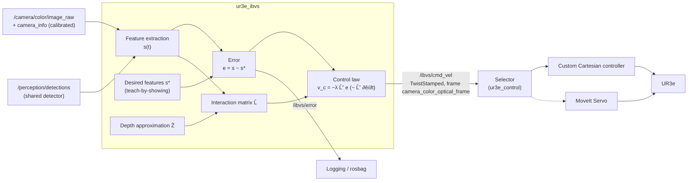

# Group A — Image-Based Visual Servoing (IBVS)

Development guide for Group A. Status: plan agreed in planning on 26/11/2026, pending confirmation by the group. Live task status: dashboard → **IBVS**, data in [`progress.yaml`](../progress.yaml) (`vs_tasks`, group `ibvs`).

Common rules that apply here: [conventions.md](conventions.md) (frames, units, twists), [architecture.md](architecture.md) (interfaces), [workflow.md](workflow.md) (Git, experiments, evidence), [VISUAL_SERVOING_BENCHMARK.md](VISUAL_SERVOING_BENCHMARK.md) (final comparison).

---

## 1. Objectives and scope

**Objective:** bring the gripper to the pre-grasp pose above the bottle cap by driving image features to their desired values, without reconstructing the cap's 3D pose.

Group A is responsible for:

| In scope (`ur3e_ibvs`) | Not in scope (shared, used as is) |
| --- | --- |
| Visual feature extraction from detections (ArUco corners, cap centre, ellipse, bottle axis) | Camera acquisition and calibration (`ur3e_camera`, `ur3e_calibration`) |
| Desired features (teach-by-showing at the pre-grasp pose) | Cap / bottle detection (`ur3e_perception`), ellipse fitting function |
| Interaction matrix and depth approximation | Rigid transforms, adjoint, projection (`ur3e_geometry`) |
| IBVS control law, gains, saturation, target-motion compensation | Twist selection, Cartesian controller, MoveIt Servo (`ur3e_control`) |
| Feature selection / observability analysis | Grasp and unscrew (`ur3e_manipulation`) |
| IBVS experiments and evidence | Kinematic simulator core (`ur3e_simulation`, shared with Group B) |

**The goal pose is the pre-grasp pose** (from `grasp.yaml`), a few centimetres above the cap along the bottle axis, where the cap is still fully visible. The last centimetres to the grasp are a short move along the bottle axis handled by the manipulation skill, because the cap leaves the field of view (or is hidden by the fingers) at grasp distance.

**Working hypothesis: eye-in-hand camera.** The mount is not decided yet (open question Q1). If the camera is fixed (eye-to-hand), the features become those of the cap *and* the gripper and the interaction matrix changes sign and frame; section 11 lists what changes.

## 2. System architecture



| Input | Source | Notes |
| --- | --- | --- |
| Raw RGB image + `camera_info` | `ur3e_camera` (D2) | K, D only from the paired `camera_info`; undistort feature points, not images |
| Detections (box, class, score) | `ur3e_perception` (D5) | Region of interest for feature extraction |
| ArUco corners | `ur3e_perception` ArUco detector | Levels L1–L2 |
| Desired features `s*` | `ur3e_ibvs/config/` | Recorded at the pre-grasp pose (D6) |
| `T_tool0_cam` (hand-eye) | TF, from `ur3e_calibration` | Only needed by the controller layer to convert the camera twist; IBVS itself works in the camera frame |

| Output | Type | Notes |
| --- | --- | --- |
| `/ibvs/cmd_vel` | `geometry_msgs/TwistStamped` | Velocity of the camera optical frame, expressed in it (D3); stamp = image stamp |
| `/ibvs/error` | `std_msgs/Float64MultiArray` | `[e (n), ‖e‖, cond(L̂), Ẑ]`, layout documented in the package |
| `/ibvs/features` (debug) | image with overlay | Current and desired features drawn, for videos |

Code layout: `ur3e_ibvs/core/` (features, interaction matrices, control law; no ROS, unit-tested) and `ur3e_ibvs/nodes/ibvs_node.py`.

## 3. Mathematical foundations

### 3.1 Feature error and control law

```math
\mathbf e = \mathbf s - \mathbf s^*, \qquad \dot{\mathbf s} = \mathbf L_s\,\mathbf v_c, \qquad \mathbf v_c = (\mathbf v, \boldsymbol\omega) \in \mathbb R^6 \text{ (camera frame)}
```

Imposing an exponential decrease `ė = −λ e` gives the basic law

```math
\mathbf v_c = -\lambda\, \widehat{\mathbf L}_s^{+}\, \mathbf e
```

with `L̂⁺ = (L̂ᵀL̂)⁻¹L̂ᵀ` when `L̂` has full column rank. Choices for `L̂` (to compare in simulation): current `L(s, Ẑ)`, desired `L(s*, Z*)` (constant), or the mean `½(L + L*)`. Local asymptotic stability holds when `L_s L̂⁺ > 0` near the goal (Chaumette & Hutchinson 2006).

### 3.2 Point features

Normalised coordinates of an undistorted image point (pixels → metres on the plane Z = 1):

```math
x = \frac{u - c_x}{f_x}, \qquad y = \frac{v - c_y}{f_y}
```

Interaction matrix of a point at depth Z:

```math
\mathbf L_{\mathbf x} =
\begin{bmatrix}
-\frac{1}{Z} & 0 & \frac{x}{Z} & xy & -(1+x^2) & y \\
0 & -\frac{1}{Z} & \frac{y}{Z} & 1+y^2 & -xy & -x
\end{bmatrix}
```

Four ArUco corners give `s ∈ ℝ⁸` and `L ∈ ℝ^{8×6}` (stacked). Three non-collinear points are the minimum for rank 6; four avoid the known global ambiguities. The marker pose from PnP gives each corner depth Z for free at levels L1–L2.

### 3.3 Cap features (markerless)

| Feature | Definition | Controls | Remarks |
| --- | --- | --- | --- |
| Centre `x_g, y_g` | Centre of the fitted cap ellipse (normalised) | Lateral translation (with Z) | The ellipse centre is **not** the image of the circle centre under perspective; bias grows with tilt and off-axis position — quantify it in IBVS-04 |
| Area `a` | `π a_px b_px` / (fx fy) | Depth | Use the normalised form `a_n = Z* √(a*/a)` |
| Normalised centre | `x_n = a_n x_g`, `y_n = a_n y_g` | Translations | For a target parallel to the image plane, the translational block of `L` for `(x_n, y_n, a_n)` is `−I₃` (Tahri & Chaumette 2005): decoupled and well conditioned |
| Ellipse shape | Eccentricity and orientation of the cap ellipse | Tilt between camera axis and bottle axis | Zero when the camera looks straight along the axis; sign of the tilt is ambiguous from one ellipse |
| Bottle axis line | Projected axis `(ρ, θ)` from the bottle silhouette or axis keypoints | Tilt direction, removes the ambiguity | Line interaction matrix: Espiau, Chaumette & Rives 1992 |
| Rotation about the axis | — | **Not observable** on a round cap | Not needed: the grasp is symmetric. Keep `ω_z` (about the bottle axis) free or regulate it to avoid wrist limits |

### 3.4 Observability and controlled degrees of freedom

The cap has 5 meaningful degrees of freedom relative to the gripper: 3 translations and 2 tilts. Rotation about the bottle axis is irrelevant. Therefore:

- **L3 (constrained motion):** `s = (x_n, y_n, a_n)` controls the 3 translations only; the orientation is held (`ω = 0`, camera kept parallel to its initial orientation). Valid when the bottle is roughly upright and the camera starts above it. Use `v = −λ L_v⁺ e` with the 3×3 translational block.
- **L4–L5 (full alignment):** add 2 tilt features (ellipse shape and/or axis line) → 5 controlled DoF; the 6th (rotation about the optical axis ≈ bottle axis at the goal) is left free by using a 5-column reduced `L` or a weighted pseudo-inverse.
- **Do not assume** centre + area are enough for 6-DoF control: they leave the tilt uncontrolled. IBVS-05 checks rank and condition number of each candidate `L` over the workspace in simulation before any robot test.

### 3.5 Depth approximation

`L` needs the depth Z of each feature.

| Option | Formula / source | Use |
| --- | --- | --- |
| ArUco PnP | Corner depths from `solvePnP` with the known marker size | L1–L2 (exact up to calibration) |
| Constant desired depth | `Z = Z*` at the pre-grasp pose, `L̂ = L(s*, Z*)` | Simple, robust near the goal |
| Apparent cap size | `Ẑ ≈ f_x · D_cap / (2 a_px)` with the known cap diameter `D_cap` and the ellipse semi-major axis `a_px` | Markerless; semi-major axis is little affected by tilt |
| Pose estimate from Group B | `Z` from `/perception/cap_pose` | Only as a comparison, not a dependency |

Large depth errors scale the gain but do not break local convergence; IBVS-09 measures the sensitivity.

### 3.6 Moving target

With a moving cap, `ė = L v_c + ∂e/∂t`. Compensate with an estimate of the target term:

```math
\mathbf v_c = -\lambda\,\widehat{\mathbf L}^{+}\mathbf e \;-\; \widehat{\mathbf L}^{+}\,\widehat{\frac{\partial \mathbf e}{\partial t}},
\qquad
\widehat{\frac{\partial \mathbf e}{\partial t}} \approx \frac{\Delta \mathbf e}{\Delta t} - \widehat{\mathbf L}\,\mathbf v_c^{\text{prev}}
```

filtered (first-order low-pass). An integral term is the simpler alternative; a Kalman filter on the cap state is an optional extension.

### 3.7 Gain and safety

- Adaptive gain (as in ViSP): `λ(‖e‖) = (λ₀ − λ∞) exp(−λ'₀ ‖e‖ / (λ₀ − λ∞)) + λ∞` — large gain near the goal, moderate far away.
- Saturate the camera twist (linear and angular separately) before publishing; the controller layer saturates again.
- No command when features are invalid or stale (image older than 3 frame periods): publish nothing, the controller timeout stops the robot (D7).

## 4. Technical approaches

| Role | Method | Purpose |
| --- | --- | --- |
| **Primary (L1–L2)** | 4 ArUco corner points, `L(s, Z_PnP)` | Validate the control law independently of markerless perception |
| **Primary (L3–L5)** | Normalised centroid + area (`x_n, y_n, a_n`) + 2 tilt features (selected in IBVS-05) | Markerless bottle servoing |
| Alternative | Same features with `L̂ = L(s*, Z*)` and `½(L + L*)` | Effect of the interaction-matrix approximation |
| Alternative | Raw centre + area (`x_g, y_g, a`) | Shows why normalised moments decouple the translations |
| Reference | ViSP `vpServo` + `vpFeaturePoint` (offline, same inputs) | Cross-check of our point-IBVS numbers |
| Validation | ArUco on the cap as ground truth; robot FK at convergence | Physical positioning error |

## 5. Implementation roadmap

Tasks are tracked in `progress.yaml` (`vs_tasks`). Thresholds are **preliminary** engineering targets.

| ID | Task | Depends on | Implementation | Deliverables | Acceptance (preliminary) | Visual evidence |
| --- | --- | --- | --- | --- | --- | --- |
| IBVS-01 | Mathematical formulation | — | Derivations of 3.1–3.6 in `ur3e_ibvs/docs/` | Formulation note; `core/interaction.py` (point, normalised moments) | Unit tests: `L` matches finite differences of the projection (< 1e-6) | Derivation figure |
| IBVS-02 | Point-based IBVS with ArUco | IBVS-01, `ur3e_geometry` | `core/features_aruco.py`, `core/control_law.py`, `nodes/ibvs_node.py` | Node publishing `/ibvs/cmd_vel` from ArUco corners | Runs on a rosbag / synthetic stream; outputs zero twist at `s = s*` | Screenshot: corners + desired corners overlay |
| IBVS-03 | Simulation | IBVS-02, shared simulator (free-flying camera) | Simulated camera, target points, Euler integration of `v_c` | Convergence script + `metrics.json` | 20 random starts (±10 cm, ±20°): mean corner error < 0.5 px within 10 s, no feature leaves the image | Plots: image trajectories, ‖e‖(t), v_c(t) |
| IBVS-04 | Cap feature extraction | WP8 (detection), shared ellipse fit | `core/features_cap.py`: centre, area, normalised moments, ellipse shape, axis line | Features on recorded datasets | Centre within 2 px of ArUco-derived reference on the test set; centre bias quantified vs tilt | Annotated images, bias plot |
| IBVS-05 | Feature selection | IBVS-03, IBVS-04 | Rank and condition number of candidate `L` over sampled poses | Short report + chosen feature set | Chosen set: rank 5 (L4–L5) or 3 (L3) everywhere in the workspace; cond(L) reported | cond(L) maps |
| IBVS-06 | Depth approximation | IBVS-04 | `Ẑ` from cap size; comparison with ArUco depth | `core/depth.py` + evaluation | Ẑ error reported vs distance; convergence kept with ±30 % depth error in simulation | Plot Ẑ vs ground truth |
| IBVS-07 | Static target on the UR3e | WP5, WP3, WP6 (camera pose), IBVS-02 (L1) then IBVS-05/06 (L3–L4) | Hardware runs at reduced speed, custom controller first | Runs logged as experiments | L1: final 3D error vs ArUco reference < 5 mm, < 2°; L3–L4: < 10 mm, < 5° | Video with feature overlay + robot view; error plot |
| IBVS-08 | Moving target | IBVS-07 | Target-motion term (3.6) | Tracking runs | Tracking error stays bounded for slow hand motions (to quantify); target never lost in the reference trials | Video; tracking-error plot |
| IBVS-09 | Robustness | IBVS-07 | Noise, partial occlusion, depth and calibration errors (simulation, then selected hardware runs) | Robustness table | Success rate vs perturbation reported | Plots success vs noise / calibration error |
| IBVS-10 | Benchmark | IBVS-07, IBVS-08 | Protocol of the benchmark document, both backends | `experiments/visual_servoing_benchmark/` entries | Complete benchmark table for IBVS | Comparative videos and plots |

## 6. Progressive development

| Level | Features | Target | Where | Exit criterion |
| --- | --- | --- | --- | --- |
| L1 | 4 ArUco corners | Static marker | Simulation → robot | IBVS-03, then IBVS-07 (L1) |
| L2 | 4 ArUco corners | Moving marker | Simulation → robot | Tracking bounded (IBVS-08 with markers) |
| L3 | Cap centre + area (normalised), orientation held | Static upright bottle | Datasets → robot | IBVS-07 (L3) |
| L4 | + ellipse / bottle-axis tilt features | Static bottle, various tilts | Simulation → robot | IBVS-07 (L4) |
| L5 | Selected markerless set | Moving bottle (fixture moved by hand, then held) | Robot | IBVS-08 markerless |

Order: theory → simulation → ArUco on the robot → real bottle. Moving to the next level requires the previous level's evidence.

## 7. Shared interfaces

| Interface | Contract | Owner |
| --- | --- | --- |
| Images | `/camera/color/image_raw`, raw, `cv_bridge` with explicit encoding; reliable QoS | `ur3e_camera` |
| Intrinsics | `/camera/color/camera_info` paired with each image (calibrated relay after WP3) | `ur3e_camera`, `ur3e_calibration` |
| Camera pose | TF `tool0 → camera_color_optical_frame` (hand-eye) | `ur3e_calibration` |
| Detections | `/perception/detections` (`vision_msgs/Detection2DArray`), classes `bottle`, `cap` | `ur3e_perception` |
| Ellipse fitting | `ur3e_perception.core` function (shared with Group B) | `ur3e_perception` |
| Pre-grasp goal | `grasp.yaml`: `T_tcp_cap_pregrasp` (same physical goal as PBVS) | shared |
| Command | `/ibvs/cmd_vel`, `TwistStamped`, `frame_id = camera_color_optical_frame` | `ur3e_ibvs` |
| Execution | Selector → custom Cartesian controller **or** MoveIt Servo; IBVS never talks to the robot directly | `ur3e_control` |
| Maths | `ur3e_geometry` (projection, skew, adjoint, transforms) — do not reimplement | shared |

## 8. Experimental validation

| Scenario | Level | Metrics |
| --- | --- | --- |
| Simulation, random starts | L1, L3, L4 | Convergence rate, time to ‖e‖ < ε, final feature error (px), cond(L), feature visibility |
| Robot, static marker | L1 | Final 3D position (mm) and axis (°) error vs ArUco reference, convergence time, path length, max twist |
| Robot, static bottle | L3–L4 | Same, ground truth from an ArUco on the cap |
| Robot, moving target | L2, L5 | Tracking error (px and mm), target-lost events, latency |
| Robustness | L1–L5 | Success rate vs image noise, occlusion, depth error, hand-eye error |

Every run: an experiment folder with `config.yaml`, `metrics.json`, plots, `notes.md` and a rosbag reference (D10). Comparison with PBVS and hybrid follows [VISUAL_SERVOING_BENCHMARK.md](VISUAL_SERVOING_BENCHMARK.md).

## 9. Visual evidence

Each contributor records the evidence of their own work (see [workflow.md](workflow.md#7-evidence-and-individual-contributions)).

| Milestone | Required evidence |
| --- | --- |
| IBVS-01 | Derivation note (PDF/Markdown), unit-test output |
| IBVS-03 | Plots: image-plane feature trajectories, ‖e‖(t) (log scale), v_c(t); a short animation of the simulated image |
| IBVS-04 | Annotated images: detected ellipse, centre, axis line; bias-vs-tilt plot |
| IBVS-05 | cond(L) and rank maps over the workspace |
| IBVS-07 | Video: robot + camera view with current (solid) and desired (dashed) features; photo of the setup; error plots |
| IBVS-08 | Video of tracking a moving marker / bottle; tracking-error plot |
| IBVS-09 | Robustness plots |
| IBVS-10 | Benchmark plots and side-by-side videos |

## 10. Resources

- F. Chaumette, S. Hutchinson. *Visual servo control, Part I: Basic approaches* (2006) and *Part II: Advanced approaches* (2007), IEEE Robotics & Automation Magazine — point interaction matrix, choice of `L̂`, stability, moving targets, eye-to-hand.
- O. Tahri, F. Chaumette. *Point-based and region-based image moments for visual servoing of planar objects*, IEEE T-RO 21(6), 2005 — normalised centroid/area features.
- F. Chaumette. *Image moments: a general and useful set of features for visual servoing*, IEEE T-RO 20(4), 2004.
- B. Espiau, F. Chaumette, P. Rives. *A new approach to visual servoing in robotics*, IEEE T-RA 8(3), 1992 — line features.
- P. Corke. *Robotics, Vision and Control*, 3rd ed., Springer 2023 — IBVS chapters and `machinevision-toolbox-python`.
- ViSP: `vpServo`, `vpFeaturePoint`, `vpFeatureMoment*`, adaptive gain; UR IBVS tutorials ([visp.inria.fr](https://visp.inria.fr)).
- Course material: Sensor_integration visual-servoing lectures 1–3 (SBC), TD3 (camera simulation), TD4 (IBVS with points).

## 11. Limitations and challenges

| Challenge | Mitigation |
| --- | --- |
| Cap leaves the image or is occluded near the grasp | Servo to the pre-grasp pose only; final approach along the axis by the manipulation skill |
| Rotation about the bottle axis unobservable | Do not control it; regulate it only to keep the wrist away from limits |
| Ellipse-centre bias under perspective | Quantify (IBVS-04); keep the cap near the image centre at the goal (teach-by-showing absorbs a constant bias) |
| Depth unknown | Cap-size approximation; IBVS tolerates moderate depth error (measure it) |
| Local minima / singular `L` with poor feature sets | IBVS-05 analysis before hardware; four points, not three |
| Features leaving the field of view during large rotations | Start from the observation pose (MoveIt), limit initial errors; hybrid controller addresses this |
| Hand occlusion with a person-held bottle | Detection on the cap top; stop when features are lost (no command → timeout) |
| Eye-to-hand mount (if chosen) | Features of both cap and gripper; `L` expressed with the robot Jacobian and opposite sign (Chaumette & Hutchinson 2007, §eye-to-hand); IBVS-01 is redone for that case |

## 12. Completion checklist

- [ ] `ur3e_ibvs` package: `core/` unit-tested, node publishing `/ibvs/cmd_vel` with the D3 convention
- [ ] Simulation results for L1, L3, L4 with `metrics.json` and plots
- [ ] Feature-selection report (rank / conditioning) and depth-approximation evaluation
- [ ] Hardware: static marker (L1), static bottle (L3–L4), moving target (L2/L5), with both execution backends at least once
- [ ] Robustness table
- [ ] Benchmark entries following the common protocol
- [ ] Evidence (photos, videos, plots) for every milestone, recorded by the contributor who did the work
- [ ] Group A section of the step-4 report written by the group
