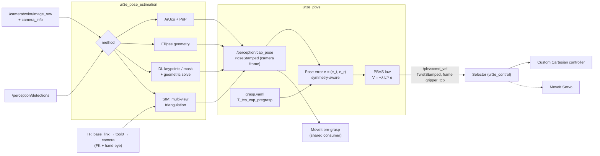

# Group B — Pose Estimation and Position-Based Visual Servoing (PBVS)

Development guide for Group B. Status: plan agreed in planning on 26/11/2026, pending confirmation by the group. Live task status: dashboard → **PBVS**, data in [`progress.yaml`](../progress.yaml) (`vs_tasks`, group `pbvs`).

Common rules that apply here: [conventions.md](conventions.md) (frames, units, twists), [architecture.md](architecture.md) (interfaces), [workflow.md](workflow.md) (Git, experiments, evidence), [VISUAL_SERVOING_BENCHMARK.md](VISUAL_SERVOING_BENCHMARK.md) (final comparison).

---

## 1. Objectives and scope

**Objective:** estimate the 3D state of the bottle cap from RGB images, then bring the gripper to the pre-grasp pose by driving the Cartesian pose error to zero.

Group B is responsible for two packages:

| `ur3e_pose_estimation` (graded step 3) | `ur3e_pbvs` (graded step 4) |
| --- | --- |
| ArUco + PnP reference pose | Desired relative pose from `grasp.yaml` |
| Classical pose from the cap ellipse | Translation and rotation error (symmetry-aware) |
| Deep-learning pose estimation (RGB) | PBVS control law, gains, saturation, target-motion term |
| Structure from Motion (multi-view triangulation) | PBVS experiments and evidence |
| Comparison of the three methods against ground truth | |

Not in scope (shared, used as is): camera acquisition and calibration, detection, ellipse fitting function, `ur3e_geometry`, twist selection and execution (custom controller, MoveIt Servo), kinematic simulator core (shared with Group A), grasp and unscrew.

`/perception/cap_pose` is also used by the MoveIt pre-grasp move and by the hybrid controller, so `ur3e_pose_estimation` is a shared service maintained by Group B, independent of the PBVS controller (D1).

**The goal pose is the pre-grasp pose** (`grasp.yaml`), a few centimetres above the cap along the bottle axis; the final approach is done by the manipulation skill.

## 2. System architecture



| Input | Source | Notes |
| --- | --- | --- |
| Raw RGB image + `camera_info` | `ur3e_camera` (D2) | K, D only from the paired `camera_info` |
| Detections | `ur3e_perception` (D5) | Region of interest |
| Camera poses `T_base_cam(t)` | TF (FK + hand-eye) | Needed by SfM and to express the cap in the base frame |
| Cap diameter, bottle model data | `ur3e_pose_estimation/config/bottles.yaml` | Measured with a caliper (WP7) |
| Goal | `grasp.yaml`: `T_tcp_cap_pregrasp` | Same physical goal as IBVS |

| Output | Type | Notes |
| --- | --- | --- |
| `/perception/cap_pose` | `geometry_msgs/PoseStamped` | Camera optical frame, image stamp; z = bottle axis out of the cap; rotation about z meaningless (D3, D6) |
| `/pbvs/cmd_vel` | `geometry_msgs/TwistStamped` | Velocity of `gripper_tcp` expressed in `gripper_tcp` (D3) |
| `/pbvs/error` | `std_msgs/Float64MultiArray` | `[e_t (3), e_r (3), ‖e_t‖, θ]` |
| Debug image | overlay | Estimated cap frame drawn on the image |

## 3. Mathematical foundations

### 3.1 Target state and symmetry

The cap state has **5 degrees of freedom**: centre `p = (X, Y, Z)` and bottle-axis direction `n` (unit vector, 2 DoF). The rotation about `n` is not observable (round cap) and not needed (symmetric grasp). The gripper, however, has a full 6-DoF pose: the controller must regulate the 5 meaningful DoF and leave the rotation about the axis free (or regulate it only to keep the wrist away from its limits).

### 3.2 ArUco + PnP (reference)

Marker of known side `s` on the cap top: `solvePnP` with `SOLVEPNP_IPPE_SQUARE` on the 4 corners returns `(rvec, tvec)` = `T_cam_marker`. With the marker centred on the cap, `p = t` and `n = z_marker`. Used as the **reference and ground truth** for every other method; its own accuracy is checked against robot motion (known displacements) and repeatability.

### 3.3 Pose from the cap ellipse (classical)

A circle of known radius `R` projects to an ellipse. In normalised coordinates the ellipse is a conic `xᵀ C x = 0` (`x = (x, y, 1)`, `C` symmetric 3×3, from the fitted ellipse and K). Back-projected, it is an elliptic cone with apex at the camera centre. Method (Safaee-Rad et al. 1992; Shiu & Ahmad 1989):

1. Fit the ellipse to the cap contour (shared RANSAC + direct least squares, Fitzgibbon 1999); undistort the contour points first.
2. Build `C` in normalised coordinates; eigen-decompose the cone matrix.
3. The plane sections of the cone that are circles give **two** solutions for the normal `n` (and the corresponding centre direction); the known radius `R` fixes the distance, hence `p`.
4. Resolve the two-fold ambiguity with the projected **bottle axis** (silhouette or keypoints), a second coaxial circle (neck ring), or temporal consistency.

Implement step 2–3 yourselves and verify on synthetic data (project a known circle, recover both solutions, check that one equals the truth) **before** using real images. Note that the ellipse centre is not the projection of the circle centre; the method above handles it, simple "centre + depth" shortcuts do not.

### 3.4 Deep-learning pose (RGB)

Collinear keypoints alone (cap top, neck, shoulder on the axis) give a weakly conditioned estimate, especially when the axis is nearly parallel to the image plane. The plan therefore uses DL for **image measurements** and geometry for the 3D solve:

| Variant | Network output | 3D solve |
| --- | --- | --- |
| **Primary candidate** | Cap mask / rim keypoints + 2 axis keypoints (YOLO-seg or YOLO-pose, fine-tuned) | Ellipse pose (3.3) with the ambiguity resolved by the predicted axis |
| Alternative | Direct regression of `p` and `n` (small head on a pretrained backbone), trained with ArUco/SfM ground truth | None |
| Baseline | Monocular metric depth (e.g. Depth Anything V2 metric) at the detected cap | Back-projection of the detection centre with the predicted depth |

The step-3 comparison is about the *pose pipeline*; the detector itself is shared (WP8).

### 3.5 Structure from Motion (multi-view, static bottle)

The robot moves the camera through N known poses `T_base_cam,i` (FK + hand-eye), so scale comes from kinematics.

- **Cap centre:** triangulate the cap-top centre from N views with the linear DLT (`P_i = K [R|t]_{cam_i, base}`, `cv2.triangulatePoints` for 2 views, own least-squares for N), refined by minimising reprojection error.
- **Bottle axis:** each view's projected axis line back-projects to a plane through the camera centre; the 3D axis is the least-squares intersection of these planes.
- Report the triangulation angle, reprojection residuals and sensitivity to bottle motion during the scan. Start with a static bottle only.

### 3.6 Pose error (symmetry-aware)

With `T_tcp_cap` the current cap pose in the tool frame (`T_tcp_cam · T_cam_cap`) and `T_tcp_cap*` the goal from `grasp.yaml`, the desired tool frame `tcp*` satisfies `T_tcp*_cap = T_tcp_cap*`, hence

```math
T_{tcp,\,tcp^*} = T_{tcp,\,cap}\; T_{tcp,\,cap^*}^{-1}
```

- **Translation error:** `e_t = t_{tcp,tcp*}` (position of the goal in the current tool frame).
- **Rotation error, symmetry-aware:** only the tilt between the tool approach axis `z_tcp` and the desired approach direction `a*` (from the measured `n` and the goal) is corrected:

```math
\mathbf u = \frac{\mathbf z \times \mathbf a^*}{\lVert \mathbf z \times \mathbf a^* \rVert},\quad
\theta = \arccos(\mathbf z \cdot \mathbf a^*),\quad
\mathbf e_r = \theta\,\mathbf u
```

`e_r` has no component about the approach axis, so the rotation about the bottle axis is left free.

### 3.7 PBVS control law

Body twist of `gripper_tcp`, expressed in `gripper_tcp`:

```math
\mathbf v = \lambda\, \mathbf e_t, \qquad \boldsymbol\omega = \lambda\, \mathbf e_r
```

This is the classical PBVS law with `s = (t, θu)` of Chaumette & Hutchinson (2006), written with the goal expressed in the current frame (`v = −λ R^T c*t_c`, `ω = −λ θu` in their notation); since `L_θu⁻¹ θu = θu`, no matrix inversion is needed. For an exact, static estimate the tool follows a straight line to the goal. A second formulation keeps the **cap** on a straight image path instead (their `s = (c t_o, θu)`):

```math
\mathbf v_c = -\lambda\left[(\,{}^{c^*}\mathbf t_o - {}^{c}\mathbf t_o) + [{}^{c}\mathbf t_o]_\times\,\theta\mathbf u\right],\qquad \boldsymbol\omega_c = -\lambda\,\theta\mathbf u
```

Both are implemented and compared in simulation (PBVS-03): straight tool path vs target kept in view.

### 3.8 Moving target

With a moving cap, add a feed-forward of the estimated cap velocity: estimate `ṗ` and `ṅ` in the base frame by filtered finite differences of `/perception/cap_pose` transformed to `base_link`, express them in the tool frame and add them to `v`, `ω`. A Kalman filter is an optional extension.

### 3.9 Error propagation

PBVS accuracy is bounded by the pose estimate and the hand-eye calibration: a hand-eye rotation error δ at distance d gives about `d·δ` of position error. Monocular depth (Z) is the least accurate component. PBVS-10 measures both effects in simulation by perturbing the pose and `T_tool0_cam`.

## 4. Technical approaches

| Subsystem | Primary | Alternatives | Reference | Validation |
| --- | --- | --- | --- | --- |
| Pose estimation | Chosen from PBVS-07 results | Ellipse geometry; DL (mask/keypoints + geometry); SfM | ArUco + PnP | Ground truth: ArUco on the cap; robot-measured displacements; depth only if allowed (Q6) |
| PBVS law | `(t, θu)` in the tool frame (straight tool path) | Object-centred `(c t_o, θu)` | ViSP `vpFeatureTranslation` / `vpFeatureThetaU` (offline) | Final pose vs ArUco reference |

## 5. Implementation roadmap

Tracked in `progress.yaml` (`vs_tasks`). Thresholds are **preliminary**.

| ID | Task | Depends on | Implementation | Deliverables | Acceptance (preliminary) | Visual evidence |
| --- | --- | --- | --- | --- | --- | --- |
| PBVS-01 | Mathematical formulation | — | Derivations of 3.1, 3.6–3.8 | Formulation note; `core/pose_error.py`, `core/control_law.py` | Unit tests: zero error at goal; symmetry (rotating the cap about its axis does not change `e`); θu matches `scipy` | Derivation figure |
| PBVS-02 | ArUco + PnP reference | IBVS/PBVS shared ArUco detector, WP3 | `ur3e_pose_estimation` `method: aruco` | `/perception/cap_pose` from markers | Repeatability (static, 100 frames): < 1 mm, < 0.5° std at 30 cm | Image with estimated frame overlay |
| PBVS-03 | Simulation | PBVS-01, shared simulator | Free-flying camera/tool, noisy pose input | Convergence script + `metrics.json` | 20 random starts: final error < 1 mm / 0.5° (noise-free); both laws compared | 3D trajectories, ‖e_t‖(t), θ(t), cap image path |
| PBVS-04 | Classical ellipse pose | Shared ellipse fit, WP3 | `method: ellipse`, ambiguity resolution | Pose node + synthetic tests | Synthetic: exact recovery; real, static, 30 cm: < 10 mm, < 5° vs ArUco | Images with both candidate normals; error plots |
| PBVS-05 | DL pose estimation | WP8 dataset, PBVS-04 | Fine-tuned YOLO-seg/pose + geometric solve; metric-depth baseline | `method: dl` + training record in `dl/` | Same test set as PBVS-04; accuracy and latency reported | Prediction overlays; training curves |
| PBVS-06 | Structure from Motion | WP4/WP5 (robot poses), WP6 | Scan trajectory, N-view triangulation of centre and axis | `method: sfm` + scan script | Static bottle: < 5 mm, < 3° vs ArUco; residuals reported | Scan video; 3D plot of rays and reconstructed axis |
| PBVS-07 | Pose benchmark | PBVS-02, 04, 05, 06 | Same dataset and viewpoints for all methods | Comparison table and plots (step-3 report) | Position (mm), axis (°), latency, robustness per viewpoint and bottle model | Comparison plots; overlay grid |
| PBVS-08 | Static target on the UR3e | WP5, WP6, PBVS-02 (L1), then best markerless method | Hardware runs, custom controller first | Runs logged as experiments | L1: final error vs ArUco < 5 mm, < 2°; markerless: < 10 mm, < 5° | Video with estimated frame overlay + robot; error plots |
| PBVS-09 | Moving target | PBVS-08 | Feed-forward term (3.8) | Tracking runs | Bounded tracking error for slow motions (to quantify); target never lost in reference trials | Video; tracking plots |
| PBVS-10 | Robustness | PBVS-08 | Pose noise, latency, hand-eye perturbation (simulation + selected hardware) | Robustness table | Success rate vs perturbation reported | Plots |
| PBVS-11 | Benchmark | PBVS-08, PBVS-09 | Common protocol, both backends | `experiments/visual_servoing_benchmark/` entries | Complete benchmark table for PBVS | Comparative videos and plots |

## 6. Progressive development

| Level | Pose estimation | Target | Exit criterion |
| --- | --- | --- | --- |
| L1 | ArUco + PnP | Static marker | PBVS-03, then PBVS-08 (L1) |
| L2 | ArUco + PnP | Moving marker | PBVS-09 with markers |
| L3 | Ellipse-based pose | Static bottle | PBVS-04 accuracy, then PBVS-08 |
| L4 | DL pose | Static bottle | PBVS-05 accuracy |
| L5 | SfM (multi-view) | Static bottle | PBVS-06 accuracy (SfM is not used for moving targets) |
| L6 | Selected single-view RGB estimator | Moving bottle | PBVS-09 markerless |

Order: theory → simulation → ArUco on the robot → real bottle. The pose estimators (L3–L5) can be developed on recorded datasets while the robot foundation is being finished.

## 7. Shared interfaces

| Interface | Contract | Owner |
| --- | --- | --- |
| Images, intrinsics | As for Group A (D2): raw images, paired calibrated `camera_info`, reliable QoS | `ur3e_camera`, `ur3e_calibration` |
| Camera pose | TF `tool0 → camera_color_optical_frame`; FK from the calibrated kinematics (D3 §7) | `ur3e_calibration`, `ur3e_bringup` |
| Detections, ellipse fit, ArUco detector | `/perception/detections`; `ur3e_perception.core` functions | `ur3e_perception` |
| Cap pose | `/perception/cap_pose` (`PoseStamped`, camera frame, z = bottle axis) — consumed by PBVS, hybrid, MoveIt | `ur3e_pose_estimation` (Group B) |
| Goal | `grasp.yaml` (`T_tcp_cap_pregrasp`, `T_tcp_cap_grasp`) | shared |
| Command | `/pbvs/cmd_vel`, `TwistStamped`, `frame_id = gripper_tcp` | `ur3e_pbvs` |
| Execution | Selector → custom Cartesian controller or MoveIt Servo | `ur3e_control` |
| Maths | `ur3e_geometry` (θu, transforms, adjoint) | shared |

## 8. Experimental validation

| Scenario | Metrics |
| --- | --- |
| Pose, static, several viewpoints (distance 20–50 cm, tilt 0–45°), each bottle model | Position error (mm), axis error (°), ambiguity-resolution success rate, latency (ms), detection-to-pose failure rate |
| Pose, held-out bottle model | Same metrics (generalisation) |
| SfM, static bottle | Error vs number of views and baseline; residuals |
| PBVS, simulation | Convergence rate, final error, tool path length, cap image path, velocity smoothness |
| PBVS, robot static (L1, L3–L4) | Final error vs ArUco, convergence time, path length, max twist |
| PBVS, robot moving (L2, L6) | Tracking error, lost-target events, latency |
| Robustness | Success vs pose noise, latency, hand-eye error |

Ground truth: an ArUco marker on the cap (measured offset to the cap centre). RealSense depth is used only if the professors allow it as ground truth (Q6). Comparison with IBVS and hybrid follows [VISUAL_SERVOING_BENCHMARK.md](VISUAL_SERVOING_BENCHMARK.md).

## 9. Visual evidence

| Milestone | Required evidence |
| --- | --- |
| PBVS-01 | Derivation note, unit-test output |
| PBVS-02 | Image with marker frame overlay; repeatability plot |
| PBVS-03 | 3D tool trajectories for both laws; error convergence plots; cap image path |
| PBVS-04 | Images with fitted ellipse and both candidate normals; synthetic-test plot |
| PBVS-05 | Prediction overlays; training/validation curves; dataset description |
| PBVS-06 | Video of the scan; 3D plot of camera poses, rays and reconstructed axis |
| PBVS-07 | Comparison table and plots (error vs distance/tilt per method) |
| PBVS-08 | Video: robot + camera view with the estimated cap frame; setup photo; error plots |
| PBVS-09 | Tracking video and plots |
| PBVS-10/11 | Robustness and benchmark plots, side-by-side videos |

## 10. Resources

- F. Chaumette, S. Hutchinson. *Visual servo control, Part I* (2006) and *Part II* (2007) — PBVS laws, θu interaction matrix, stability.
- R. Safaee-Rad, I. Tchoukanov, K. Smith, B. Benhabib. *Three-dimensional location estimation of circular features for machine vision*, IEEE T-RA 8(5), 1992; R. Shiu, S. Ahmad. *3D location of circular and spherical features by monocular model-based vision*, IEEE SMC 1989 — circle pose from an ellipse.
- A. Fitzgibbon, M. Pilu, R. Fisher. *Direct least square fitting of ellipses*, IEEE TPAMI 21(5), 1999; M. Fischler, R. Bolles. *RANSAC*, CACM 1981.
- S. Garrido-Jurado et al. ArUco, Pattern Recognition 2014; T. Collins, A. Bartoli. *Infinitesimal plane-based pose estimation* (IPPE), IJCV 2014.
- R. Hartley, A. Zisserman. *Multiple View Geometry*, 2nd ed., 2004 — triangulation, DLT, line back-projection.
- Ultralytics YOLO (seg / pose), Depth Anything V2 (metric) — DL variants; licences to check (Ultralytics is AGPL-3.0).
- ViSP `vpFeatureThetaU`, `vpFeatureTranslation`, PBVS tutorials for Universal Robots.
- Course material: Sensor_integration lectures (SBC), TD1 (PBVS); STPR HW03–04 (RANSAC), HW05 (two-view triangulation); Mezouar camera-geometry lecture.

## 11. Limitations and challenges

| Challenge | Mitigation |
| --- | --- |
| Two-fold ellipse ambiguity | Bottle-axis cue, second coaxial circle, temporal consistency; report the resolution success rate |
| Depth (Z) is the least accurate component | Known cap diameter per bottle model; compare with SfM; tolerance checked in PBVS-10 |
| Hand-eye error propagates directly into PBVS | Validate hand-eye first (WP6); PBVS-10 quantifies the effect |
| Small cap at long distance | Approach from the observation pose; higher resolution profile if needed (D2) |
| SfM needs a static bottle and robot motion | Static evaluation only; not used in the moving-target loop |
| DL needs labelled data | Shared dataset (WP8), auto-labelling with ArUco/SfM ground truth, held-out bottle model |
| Rotation about the axis undefined | Symmetry-aware error (3.6); regulate it only for wrist limits / cable |
| Target leaves the field of view with the straight tool path | Compare with the object-centred law (3.7); hybrid controller |

## 12. Completion checklist

- [ ] `ur3e_pose_estimation`: `aruco`, `ellipse`, `dl`, `sfm` methods behind one `/perception/cap_pose` interface, `core/` unit-tested
- [ ] Pose benchmark (PBVS-07) with ground truth, per viewpoint and bottle model — step-3 report material
- [ ] `ur3e_pbvs`: symmetry-aware error, both laws, node publishing `/pbvs/cmd_vel` (D3)
- [ ] Simulation results, hardware static (L1, markerless) and moving-target results, with both execution backends at least once
- [ ] Robustness table and benchmark entries
- [ ] Evidence (photos, videos, plots) for every milestone, recorded by the contributor who did the work
- [ ] Group B sections of the step-3 and step-4 reports written by the group
