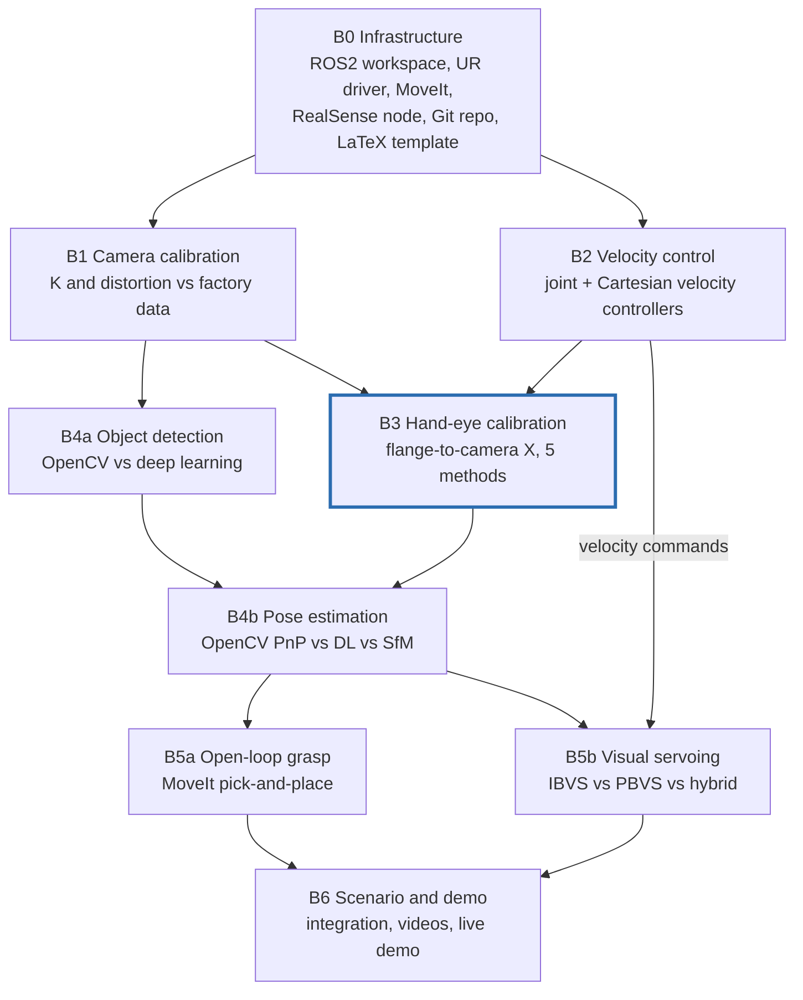
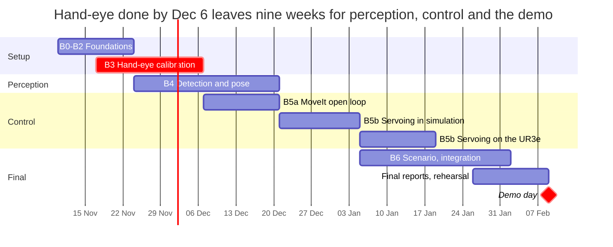

# Vision-Based UR3e Project — Group Plan

Started 10/11/2026. Edit this file through a pull request like any other file.

## Project in one paragraph

We build a vision-guided pick-and-place on a UR3e (ROS2) with an Intel RealSense used in RGB-only mode: detect an object, estimate its pose, then grasp it with visual servoing. The work follows 5 steps from Project-3A (Mezouar, Ozgur, Alkhatib); each step gets its own LaTeX report. The final review is a 15-minute presentation plus a 5-minute live demo on 09/02/2027 (afternoon), per the updated Project-3A.pdf (version of 06/10/2026, sent by Alkhatib on 10/11).

| Step | What the brief asks |
| --- | --- |
| 1. Materials | Image acquisition and processing (OpenCV, DL), camera calibration checked against RealSense factory data; robot control with joint and Cartesian velocity controllers (ROS2) |
| 2. System setup | Hand-eye calibration |
| 3. Perception | Detection and pose of ArUco markers and of the graspable object; detection: OpenCV vs deep learning; pose: OpenCV vs deep learning vs structure-from-motion |
| 4. Control | Open loop with MoveIt; closed loop: IBVS vs PBVS vs hybrid visual servoing |
| 5. Scenario | A real-world use case (medical, industrial, domestic, service, outdoor) that uses steps 1 to 4 |

**Open questions for the professors**

- [x] Demo date: 09/02/2027 (afternoon), confirmed by the updated Project-3A.pdf
- [ ] TP1 cites ROS1 packages (Universal_Robots_ROS_Driver, cambel/ur3) while the project is ROS2: which ROS2 distro (Humble or Jazzy) runs on the lab PCs?
- [ ] Is the camera mounted on the wrist (eye-in-hand) or fixed in the cell (eye-to-hand)?
- [ ] How many lab slots on the real robot per week, and can we book extra ones?
- [ ] Which object(s) are we allowed to grasp, and is a gripper available?

## Camera calibration and ArUco pose estimation

Everything downstream depends on good intrinsics, so camera calibration comes first; ArUco pose is then a direct PnP problem.

**Camera calibration (step 1)**

1. Print a checkerboard or ChArUco board, measure the square size in mm.
2. Take 20 to 30 images covering the whole image area, with tilts up to about 45°.
3. Run `cv2.calibrateCamera` (or `cv2.aruco.calibrateCameraCharuco`) to get K and the distortion coefficients.
4. Compare with the factory intrinsics published on the RealSense `/camera/color/camera_info` topic: fx, fy, cx, cy and the reprojection error in pixels go in the report.

**ArUco pose (start of step 3)**

1. Detect corners with `cv2.aruco.ArucoDetector` (choose one dictionary for the group, e.g. DICT_4X4_50).
2. Estimate the marker pose in the camera frame with `cv2.solvePnP(objectPoints, corners, K, dist, flags=cv2.SOLVEPNP_IPPE_SQUARE)`, where objectPoints are the 4 corners of a square of the real marker length.
3. Output: rotation vector and translation, i.e. the transform camera to marker.

```math
{}^{c}T_{m} = \begin{bmatrix} R(r_{vec}) & t_{vec} \\ 0 & 1 \end{bmatrix}
```

RGB-only means the only depth we get is from the known marker size (or from object models / multi-view). This matters later for IBVS, which needs the depth Z of each feature.

## Hand-eye calibration

Hand-eye calibration finds the fixed transform X between the robot flange (gripper) and the camera; without it, no camera measurement can be turned into a robot target.

**The equation (eye-in-hand case)**

For two robot poses i and j looking at the same fixed board:

```math
A = ({}^{b}T_{g_j})^{-1}\,{}^{b}T_{g_i}, \qquad B = {}^{c}T_{t_j}\,({}^{c}T_{t_i})^{-1}, \qquad A\,X = X\,B, \qquad X = {}^{g}T_{c}
```

If the camera turns out to be fixed in the cell (eye-to-hand), the unknown becomes base to camera; OpenCV handles it by inverting the robot poses.

**Procedure**

1. Fix a ChArUco board in the workspace; it must not move during collection.
2. Move the robot through 15 to 25 poses with large, varied rotations about all 3 axes (rotation diversity matters more than the number of poses).
3. At each pose record base to gripper from TF (`base_link` to `tool0`) and camera to board from solvePnP.
4. Solve with `cv2.calibrateHandEye(R_g2b, t_g2b, R_t2c, t_t2c, method=...)`.
5. Run all 5 methods (TSAI, PARK, HORAUD, ANDREFF, DANIILIDIS) and compare them in the report.

**Validation**

Compute the board pose in the base frame from every view; with a good X it stays constant. Its spread (mm, degrees) is our error metric.

```math
{}^{b}T_{t} = {}^{b}T_{g}\;X\;{}^{c}T_{t}
```

Second check: touch a known board corner with the tool tip and compare with the predicted position. The ROS2 package `easy_handeye2` can automate collection, but we keep our own OpenCV script so the report explains the method.

## Task blocks

The project splits into 9 blocks; B1 (camera) and B2 (velocity control) can start in parallel right after the setup, and nothing past perception works until B3 is validated.



B2 feeds B5b directly: visual servoing sends its commands through the velocity controllers.

## Who does what

Each member leads one track and backs up another; hand-eye calibration is on the critical path, so it gets two people. Roles agreed on 10/11/2026.

| Role | Member | Leads | Backs up | First deliverable |
| --- | --- | --- | --- | --- |
| R1 Robot and ROS2 | Kamil BENMADI | B0 infra, B2 velocity controllers, then B5b visual servoing | B3 data collection | Robot moving in Gazebo and on the real UR3e via a Cartesian velocity command |
| R2 Calibration | Mohamed Ali JOMAA GHOUIL | B1 camera calibration, B3 hand-eye | B4b pose | K and distortion vs factory values; X with error metrics |
| R3 Classic vision | Kevin PALAIO CORREIA | ArUco pipeline, OpenCV detection and PnP pose, then B5a MoveIt pick | B3 | Live ArUco pose published on a ROS2 topic |
| R4 Deep learning | Mohamed Taher GUERBEJ | Dataset, DL detector (e.g. YOLO), DL pose | B4a OpenCV comparison | Labelled dataset of our object, first trained detector |
| R5 SfM and integration | Dina MOUTIH | Structure-from-motion pose, B6 scenario, LaTeX template and report merging | B5a | Report template in the repo, scenario proposal |

## Timeline

Hand-eye calibration validated by 6 December is the date that protects the rest of the plan; the holidays go to visual servoing in simulation so January is spent on the real robot.



Reports for steps 1 and 2 are written as soon as B3 is validated, not in January.

## Deliverables and working rules

Each step ends with a LaTeX report containing: problem formulation, solution methods, block diagrams and algorithms, code, and results with figures and videos.

- **Reports are checked for plagiarism and AI-generated content.** We write the text ourselves; tools can help us understand and debug, not write the report.
- **One shared Git repo** (this one, private; rules in [CONTRIBUTING.md](../CONTRIBUTING.md)): one ROS2 package per block, `main` always runs, each feature on its own branch, reviewed by one other member before merge.
- **One LaTeX template** in the repo (`reports/template/`), shared bibliography, same figure style.
- **Record as we go**: every working experiment gets a short video and its raw data (bags, images), so results sections are not rebuilt in January.
- **Simulation first**: test in Gazebo / RViz before using lab time on the real UR3e; keep a speed limit and the e-stop in reach on the real robot.
- **Weekly sync** (15 min): each track says what works, what is blocked, what is next; tick the boxes below.

**This week**

- [ ] Answer the open questions with the professors
- [x] Repo created and pushed
- [ ] ROS2 workspace builds on every laptop
- [ ] Robot moving in Gazebo with MoveIt (TP1 ported to ROS2)
- [ ] Camera calibration images taken, first K computed
- [ ] ArUco detected live with a pose printed
