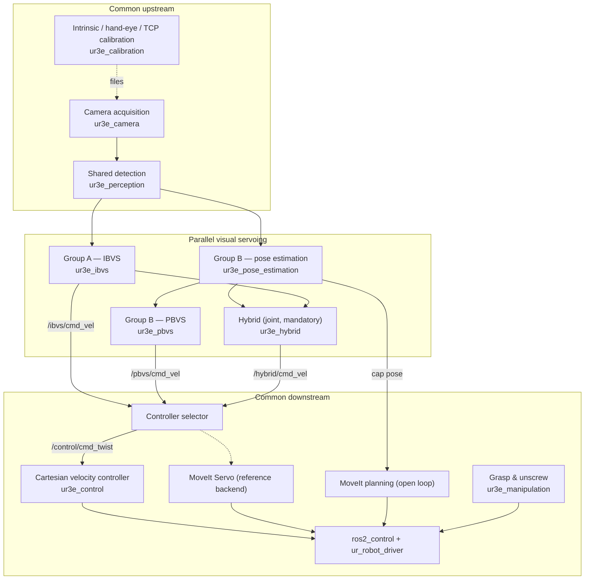

# System architecture

Status: target architecture agreed in planning on 26/11/2026 (decisions D1–D14, see [decisions.md](decisions.md)), pending confirmation by the whole group. Packages are created only when they are needed.

## 1. Use case

A person who can use only one hand holds a water bottle. The robot detects the bottle and its cap, approaches it, follows small bottle motions with visual servoing, grasps the cap, unscrews it, detects that it is free and lifts it about 3 cm.
Development starts with a **bottle in a fixture**. A person-held bottle is used only after validation, a risk assessment and approval from the professors.

## 2. Three blocks



Only one visual controller and one motion backend command the robot at a time.

## 3. Packages

One folder per package directly under `ros2_ws/src/`. Each package with algorithms has a `core/` module (pure Python, no ROS imports, unit-tested) and a `nodes/` module (ROS 2 wrappers).

| Package | Block | Responsibility | Reuses | When |
| --- | --- | --- | --- | --- |
| `ur3e_bringup` | Common | Launch files, system configuration, **promoted calibration files** | `ur_robot_driver`, `realsense2_camera`, MoveIt launch | Phase 1 |
| `ur3e_description` | Common | Project cell xacro: includes the official UR3e macro, adds gripper, camera, mount, `gripper_tcp`, fixture | `ur_description`, `realsense2_description` (never copied) | When the gripper/mount is known |
| `ur3e_moveit_config` | Downstream | SRDF, kinematics and Servo configuration for our cell | MoveIt Setup Assistant; `ur_moveit_config` until then | Later |
| `ur3e_camera` | Upstream | `stream_check`, `dataset_recorder`, calibrated `camera_info` relay | `realsense2_camera` (not wrapped), `rosbag2` | Phase 1 |
| `ur3e_calibration` | Upstream | Intrinsic, hand-eye and TCP calibration (collection nodes + offline solvers) | OpenCV; `camera_calibration`, `easy_handeye2` as references only | Phase 1 |
| `ur3e_geometry` | Common | Minimal maths: rigid transforms, rotations, skew, adjoint, camera projection | NumPy, SciPy `Rotation` | With the first user |
| `ur3e_perception` | Upstream | Shared detection (OpenCV and DL inference), ArUco reference, ellipse fitting | OpenCV, Ultralytics (inference); training lives in `dl/` | Phase 1–2 |
| `ur3e_pose_estimation` | Group B | Cap pose: ellipse geometry, DL keypoints, SfM | OpenCV | Phase 2 |
| `ur3e_ibvs` | Group A | Visual features, interaction matrix, IBVS law | — | Phase 2 |
| `ur3e_pbvs` | Group B | Pose error, PBVS law | — | Phase 2 |
| `ur3e_hybrid` | Joint | 2.5D / hybrid law, imports the pure `core/` of IBVS and PBVS | — | Phase 2–3 (mandatory) |
| `ur3e_control` | Downstream | Kinematics, Jacobian, DLS inverse, limits, timeout, selector, controller switching | `forward_velocity_controller`, `controller_manager` | Phase 1 |
| `ur3e_manipulation` | Downstream | Gripper client, grasp, unscrew, cap-release detection | UR `force_mode_controller`, gripper driver | Phase 1 (feasibility) → 3 |
| `ur3e_task_manager` | Downstream | State machine for the whole task | Plain Python first | Phase 3 |
| `ur3e_simulation` | Common | Kinematic visual servoing simulator (pure Python); Gazebo cell later | `ur_simulation_gz` (later) | Phase 2 |
| `ur3e_learning` | Optional | Deployed learned controller (publishes on the twist interface) | — | Deferred |
| `ur3e_interfaces` | Common | Custom messages, only if standard ones are insufficient | — | Deferred |

The current `ros2_ws/src/` contains placeholder folders from the initial scaffold (`calibration/`, `perception/`, `servoing/`, `ur3e_bringup/`, `ur3e_velocity/`). They are replaced by the packages above as each package is created; `ur3e_velocity` becomes `ur3e_control`.

### Dependency rules

1. **Runtime** communication only through topics, TF, actions, services and configuration files.
2. **Library** imports only towards pure `core/` libraries: `ur3e_geometry` (everyone), `ur3e_perception.core` (IBVS, pose estimation), `ur3e_ibvs.core` and `ur3e_pbvs.core` (hybrid).
3. A controller never imports the implementation of what it subscribes to (PBVS does not import pose estimation).
4. `ur3e_control` never depends on IBVS, PBVS, hybrid or learned controllers.
5. No node reads another package's private files; shared configuration lives in `ur3e_bringup/config/`.

## 4. Shared interfaces

| Interface | Type | Producer → consumers | Notes |
| --- | --- | --- | --- |
| `/camera/color/image_raw` | `sensor_msgs/Image` | camera source → perception, IBVS, recorders | Raw, RGB only, encoding requested explicitly |
| `/camera/color/camera_info` | `sensor_msgs/CameraInfo` | calibrated relay (or factory) → all vision nodes | Same stamp as the image; must match the image resolution |
| `/camera/color/camera_info_factory` | `sensor_msgs/CameraInfo` | RealSense driver → relay, comparison | Remapped factory intrinsics |
| `/perception/detections` | `vision_msgs/Detection2DArray` | `ur3e_perception` → IBVS, pose estimation | Classes `bottle`, `cap`; image stamp and frame |
| `/perception/cap_pose` | `geometry_msgs/PoseStamped` | `ur3e_pose_estimation` → PBVS, hybrid, MoveIt pre-grasp | In the camera optical frame; z = bottle axis |
| `/ibvs/cmd_vel`, `/pbvs/cmd_vel`, `/hybrid/cmd_vel` (`/learned/cmd_vel` later) | `geometry_msgs/TwistStamped` | controllers → selector | Twist convention in [conventions.md](conventions.md#4-twists-cartesian-velocities) |
| `/ibvs/error`, `/pbvs/error` | `std_msgs/Float64MultiArray` | controllers → logging | Layout documented in each package |
| `/control/cmd_twist` | `geometry_msgs/TwistStamped` | selector → Cartesian controller or Servo adapter | One active source |
| `/forward_velocity_controller/commands` | `std_msgs/Float64MultiArray` | Cartesian controller (or Servo) → UR driver | Joint velocities, rad/s |
| `/joint_states`, `/tf`, `/tf_static` | standard | driver, `robot_state_publisher`, calibration | One consistent robot model |
| `/force_torque_sensor_broadcaster/wrench` | `geometry_msgs/WrenchStamped` | UR driver → manipulation | Availability to verify on the robot |
| Gripper | `control_msgs/action/GripperCommand` | manipulation → gripper driver (or adapter) | Gripper model not yet known |

### Image source contract

The same downstream nodes work with three interchangeable sources, selected in `ur3e_bringup`: the RealSense camera, a recorded `rosbag2` (`ros2 bag play --clock`, `use_sim_time`), and later a simulated camera. All publish the topics above with the frame `camera_color_optical_frame`. Saved image folders are consumed offline by scripts that call the `core/` functions directly (no ROS needed).

Rules: consumers use `header.stamp` (never "now") and look up TF at that stamp; images older than a few frame periods are treated as "no measurement"; the controller timeout (D7) is the final safety net.

## 5. Calibration flow

```text
collection node / offline solver  →  experiments/calibration/<run>/ (results, metrics.json)
        → acceptance criteria met?  →  reviewed commit promotes the file into
          ur3e_bringup/config/calibration/   →   launch files read it
```

| File | Format | Naming |
| --- | --- | --- |
| Intrinsics | ROS `camera_info` YAML | `<camera_serial>_<width>x<height>.yaml` |
| Hand-eye, TCP | YAML: parent, child, translation (m), quaternion (x, y, z, w), method, date, git commit, dataset id, validation errors | `hand_eye.yaml`, `tcp.yaml` |
| Robot kinematics | `ur_calibration` output | `ur3e_kinematics.yaml` |

Installed package files are never modified at runtime.

## 6. Control flow

```text
/<law>/cmd_vel ─► selector ─► /control/cmd_twist ─► Cartesian controller ─► /forward_velocity_controller/commands
                                                 └► (alternative) MoveIt Servo adapter ─┘
MoveIt planning ─► scaled_joint_trajectory_controller   (open-loop moves: home, observe, pre-grasp)
```

- Cartesian controller: transform the twist to `tool0` (adjoint), then `q̇ = Jᵀ (J Jᵀ + μ² I)⁻¹ V`, then joint velocity and position limits, Cartesian saturation, timeout → zero velocity.
- MoveIt and velocity control use different controllers that claim the same joints; `ur3e_control` switches them through `controller_manager`.
- Order of validation: unit tests → mock hardware / URSim → real robot at reduced speed. No robot motion is started automatically.

## 7. Methodology for every algorithmic subsystem

| Role | Meaning |
| --- | --- |
| **Primary** | Implementation intended for integration |
| **Alternative** | Different method, compared with a clear purpose |
| **Reference** | Established external implementation for cross-validation |
| **Validation** | Independent experiment against ground truth or physical measurement |

Agreement between implementations is cross-validation, not validation. Differences in *targets or data* are kept apart from differences in *solvers*. The final method is chosen from results, and the choice is documented in the experiment and on the dashboard.

| Subsystem | Primary candidate | Alternatives | References | Independent validation |
| --- | --- | --- | --- | --- |
| Intrinsic calibration | ChArUco + OpenCV `calibrateCamera` | Chessboard target; own Zhang solver (optional) | ROS `camera_calibration`, RealSense factory | Held-out images, repeatability across sessions |
| Hand-eye | OpenCV `calibrateHandEye` (method chosen from results) | Tsai, Park, Horaud, Andreff, Daniilidis | `easy_handeye2` | Independent robot poses |
| Forward kinematics / Jacobian | Own, from calibrated kinematics | — | TF from `robot_state_publisher`, finite differences | Measured TCP motion |
| Cartesian control | Own DLS controller | — | MoveIt Servo | Tracking error on the robot |
| Detection | Fine-tuned YOLO | HSV + contours + ellipse | COCO-pretrained YOLO | ArUco ground truth, labelled test session |
| Pose estimation | To be chosen from results | Ellipse geometry, DL keypoints, SfM | ArUco PnP | Ground truth (ArUco; depth only if allowed) |
| Visual servoing | IBVS, PBVS, hybrid (all mandatory) | — | ViSP (optional) | Same initial conditions and target motions |
| Robot learning | Optional, deferred | — | Classical controller as teacher | Same protocol as visual servoing |

Results are stored in `experiments/` (see [workflow.md](workflow.md#experiments)) and displayed by the dashboard.

## 8. Deferred on purpose

Custom replay node, latency benchmarking, exhaustive comparisons, custom messages, large maths framework, project-management automation, live 3D visualisation, extensive CI/CD, Gazebo camera simulation, robot learning. Each comes back only when a concrete need appears.
